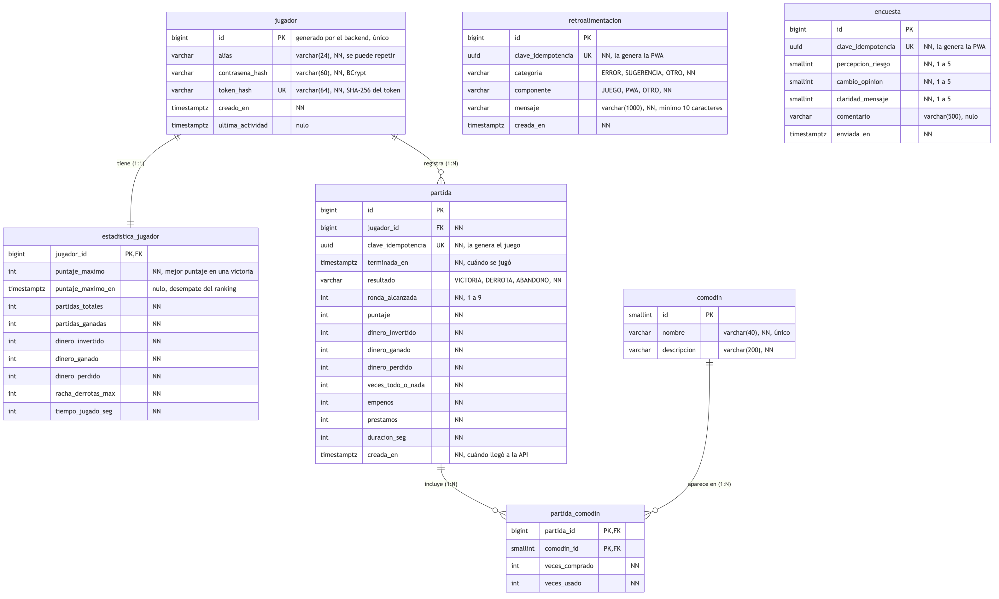

# Fat Fish API

[](https://github.com/Anuma-Games/fat-fish-api/actions/workflows/ci.yml)

Prototipo del backend del videojuego **Fat Fish** (proyecto integrador, grupo IDGS101N, UTCH).

El juego registra al jugador, guarda cada partida en su equipo (local first) y la envía a esta API
cuando hay conexión. La API guarda cada partida una sola vez, actualiza las estadísticas del jugador
y expone su perfil, historial, ranking mundial y búsqueda de jugadores para la PWA y la app móvil, que también
envía retroalimentación y la encuesta anónima.

## Tecnologías

- Java 21, Spring Boot 4 (Web MVC, Data JPA, Validation, Actuator) y `spring-security-crypto` (BCrypt)
- PostgreSQL 17 (local con Docker Compose) y migraciones con Flyway
- OpenAPI / Swagger UI (springdoc-openapi)
- JUnit 5, Mockito, MockMvc y pruebas de integración contra PostgreSQL real
- GitHub Actions (CI) y Dockerfile multi-stage

## Estructura

```
src/main/java/com/fatfish/api
├── controller   # Endpoints REST (/api/juego y /api/pwa)
├── service      # Reglas de negocio: token, idempotencia, estadísticas, bloqueo de sesión
├── repository   # Spring Data JPA
├── model        # Entidades JPA
├── dto          # Contrato JSON del juego (dto/juego) y de la PWA (dto/pwa)
├── exception    # Manejo de errores (Problem Details, mensajes en español)
└── config       # OpenAPI, llave de la API (ApiKeyFilter) y límite de peticiones (RateLimitFilter)
src/main/resources/db/migration   # Migraciones de Flyway (V1__esquema_inicial.sql, V2__…)
docs/diagramas/modelo-datos.mmd   # Diagrama del modelo de datos (copia de referencia)
.github/workflows/ci.yml          # Pipeline de CI
.github/scripts/test_summary.py   # Resumen de pruebas para GitHub Actions
```

## Requisitos

- JDK 21
- Docker Desktop (o Docker Engine con Compose)
- No hace falta instalar Maven: el proyecto incluye Maven Wrapper (`./mvnw`).

## Uso de la API en Cloud Run

**URL base (pruebas):** `https://fat-fish-api-31376020434.us-south1.run.app` (solo HTTPS).
Documentación en `/swagger-ui.html` y salud en `/actuator/health`. Los clientes leen la URL de un archivo de
configuración, no la escriben en el código.

### Qué se necesita

| Control | Qué es | Cabecera |
|---|---|---|
| **Llave de la API** | Identifica a la aplicación que llama (juego, PWA). **Es pública por diseño**: la PWA la envía desde el navegador (ver [Seguridad](#seguridad-la-llave-es-pública-límites-y-bloqueo)). Se pide al responsable de la API y no se sube a Git | `X-Api-Key: <llave>` |
| **Token del jugador** | Lo entrega `registro` o `sesion` y autoriza escribir partidas | `Authorization: Bearer <token>` |

| Endpoint | Llave | Token | Éxito | Errores |
|---|:---:|:---:|---|---|
| `POST /api/juego/registro` | Sí | No | `201` | `400`, `429` |
| `POST /api/juego/sesion` | Sí | No (id y contraseña) | `200` | `400`, `401`, `429` |
| `PUT /api/juego/contrasena` | Sí | Sí | `204` | `400`, `401` |
| `POST /api/juego/partidas` | Sí | Sí | `201` (`200` si ya existía) | `400`, `401` |
| `GET /api/pwa/jugadores?busqueda=` | Sí | No | `200` (lista vacía si no hay coincidencias) | `400` |
| `GET /api/pwa/perfil?id=` | Sí | No | `200` | `400`, `404` |
| `GET /api/pwa/partidas?id=` | Sí | No | `200` | `400`, `404` |
| `GET /api/pwa/ranking` | Sí | No | `200` | `400` |
| `POST /api/pwa/retroalimentacion` | Sí | No | `201` (`200` si ya existía) | `400`, `429` |
| `POST /api/pwa/encuesta` | Sí | No | `201` (`200` si ya existía) | `400`, `429` |
| `GET /actuator/health` | No | No | `200` | |

### Primera prueba

```bash
URL=https://fat-fish-api-31376020434.us-south1.run.app
KEY='<llave-del-equipo>'

curl -i $URL/actuator/health                                   # 200, sin llave
curl -i "$URL/api/pwa/perfil?id=1"                             # 403: falta la llave
curl -i -H "X-Api-Key: $KEY" "$URL/api/pwa/perfil?id=1"        # 200, o 404 si no existe
```

En PowerShell usa `curl.exe`. En Postman, define `X-Api-Key: {{apiKey}}` a nivel de colección.

### Errores

Formato Problem Details (RFC 9457), en español.

| Código | Qué hacer |
|---|---|
| `400` | Corregir el cuerpo (`errors` lista los campos). No reintentar igual |
| `401` | Token ausente, inválido o reemplazado: pedir `POST /api/juego/sesion`. En `sesion` también significa contraseña incorrecta o jugador bloqueado temporalmente (la respuesta es la misma, a propósito) |
| `403` | Falta la llave o es inválida. **No pedir al jugador iniciar sesión** |
| `404` | El jugador no existe |
| `429` | Se pasó el límite de peticiones de la IP. Esperar los segundos que indica la cabecera `Retry-After` y reintentar con la misma clave de idempotencia |
| `5xx` o red | Reintentar con espera creciente y la misma clave de idempotencia |

### Seguridad: la llave es pública, límites y bloqueo

**La llave `X-Api-Key` no es un secreto.** La PWA la manda desde el navegador, así que cualquiera puede leerla en el
bundle de la aplicación. Sirve para identificar al cliente y descartar tráfico que no viene de Fat Fish. Lo que protege
los datos es el **token Bearer** del jugador y, en los endpoints que no lo piden, los **límites de peticiones**.

| Endpoint | Escribe en la BD | Pide token | Qué lo protege |
|---|---|:---:|---|
| `POST /api/juego/partidas` | Sí | Sí | El token del jugador |
| `PUT /api/juego/contrasena` | Sí | Sí | El token del jugador |
| `POST /api/juego/registro` | Crea al jugador | No (el token se obtiene aquí) | Límite por IP: 5 por hora |
| `POST /api/juego/sesion` | Genera un token e invalida el anterior | No | Límite por IP: 10 por minuto, y bloqueo temporal por jugador |
| `POST /api/pwa/retroalimentacion` | Sí | No (anónima por diseño) | Límite por IP: 10 por minuto |
| `POST /api/pwa/encuesta` | Sí | No (anónima por diseño) | Límite por IP: 10 por minuto |
| `GET /api/pwa/*` | No | No | Solo la llave (consultas de lectura) |

**Límite de peticiones por IP** (`RateLimitFilter`). Aplica a los `POST` de `registro`, `sesion`, `retroalimentacion` y
`encuesta`. Al pasarse responde `429 Too Many Requests` con la cabecera `Retry-After` (segundos que faltan para que
termine la ventana) y el mismo formato `application/problem+json` que `ApiKeyFilter`.

- Es un contador en memoria con ventana fija, suficiente porque la API corre en una sola instancia. Cada IP tiene un
  contador por endpoint.
- La IP del cliente es la **primera** de la cabecera `X-Forwarded-For`, que es donde Cloud Run la entrega (no
  `getRemoteAddr()`). Si la cabecera no existe, usa `getRemoteAddr()`.
- `/api/juego/partidas`, `/api/juego/contrasena` y los `GET` no se limitan: ya piden token o solo leen.

**Bloqueo temporal de `/api/juego/sesion` por jugador** (`LoginAttemptService`). Tras varios fallos seguidos, el
jugador queda bloqueado un tiempo, **sin importar la IP**.

- Por defecto: 5 fallos seguidos bloquean 15 minutos.
- Un jugador bloqueado recibe el mismo `401` y el mismo mensaje que una contraseña incorrecta, sin `Retry-After` y sin
  validar la contraseña, para no revelar si el jugador existe.
- Los fallos se cuentan por id aunque el jugador no exista, así la respuesta es idéntica en los dos casos.
- Un inicio de sesión correcto reinicia la cuenta de fallos.

**Propiedades.** Todo se configura por propiedades o variables de entorno y **viene apagado por defecto**, así que en
local y en CI no hay límites. Cloud Run los enciende con variables de entorno.

| Propiedad | Variable de entorno | Valor por defecto |
|---|---|---|
| `fatfish.security.rate-limit.enabled` | `FATFISH_SECURITY_RATE_LIMIT_ENABLED` | `false` |
| `fatfish.security.rate-limit.register-per-hour` | `FATFISH_SECURITY_RATE_LIMIT_REGISTER_PER_HOUR` | `5` |
| `fatfish.security.rate-limit.login-per-minute` | `FATFISH_SECURITY_RATE_LIMIT_LOGIN_PER_MINUTE` | `10` |
| `fatfish.security.rate-limit.feedback-per-minute` | `FATFISH_SECURITY_RATE_LIMIT_FEEDBACK_PER_MINUTE` | `10` |
| `fatfish.security.rate-limit.survey-per-minute` | `FATFISH_SECURITY_RATE_LIMIT_SURVEY_PER_MINUTE` | `10` |
| `fatfish.security.login-lockout.enabled` | `FATFISH_SECURITY_LOGIN_LOCKOUT_ENABLED` | `false` |
| `fatfish.security.login-lockout.max-attempts` | `FATFISH_SECURITY_LOGIN_LOCKOUT_MAX_ATTEMPTS` | `5` |
| `fatfish.security.login-lockout.minutes` | `FATFISH_SECURITY_LOGIN_LOCKOUT_MINUTES` | `15` |

**Limitaciones.**

- Los contadores y los bloqueos viven en la memoria de la instancia: se pierden al reiniciar la API o al desplegar una
  revisión nueva, y no se comparten entre instancias. Por eso Cloud Run debe tener **una sola instancia**
  (*Cantidad máxima de instancias* en `1`).
- Un cliente puede mandar su propia cabecera `X-Forwarded-For`. Cloud Run agrega la IP real al final de la lista, y el
  filtro toma la primera, como pide el ticket FF; si se quiere cerrar ese hueco, `clientIp` en `RateLimitFilter` debe
  tomar la última entrada en lugar de la primera.

### Configuración en Cloud Run

La API corre en Cloud Run con el perfil `cloudrun` y se conecta a Cloud SQL con el conector de Google, sin IPs
autorizadas. La contraseña de la base y la llave de la API se guardan en Secret Manager y llegan como variables de
entorno; nunca se escriben en el repositorio.

| Variable | Uso |
|---|---|
| `SPRING_PROFILES_ACTIVE` | `cloudrun`: pool de conexiones pequeño, Flyway activo, URLs `https` en Swagger y apagado ordenado |
| `DB_URL` | Conexión por el conector: `jdbc:postgresql:///fatfish?cloudSqlInstance=<proyecto>:<región>:<instancia>&socketFactory=com.google.cloud.sql.postgres.SocketFactory` |
| `DB_USER` y `DB_PASSWORD` | Usuario y contraseña de la base (la contraseña, desde Secret Manager) |
| `FATFISH_SECURITY_API_KEY` | Llave que se compara con la cabecera `X-Api-Key` (desde Secret Manager). Si está vacía, el filtro queda apagado |
| `FATFISH_SECURITY_API_KEY_REQUIRED` | Con `true`, la aplicación no arranca si falta la llave, para no quedar abierta por error |
| `FATFISH_SECURITY_RATE_LIMIT_ENABLED` | Con `true`, enciende el límite de peticiones por IP. **Obligatoria** para activarlo |
| `FATFISH_SECURITY_LOGIN_LOCKOUT_ENABLED` | Con `true`, enciende el bloqueo de `/sesion` por jugador. **Obligatoria** para activarlo |
| `FATFISH_SECURITY_RATE_LIMIT_REGISTER_PER_HOUR` | Opcional. Registros por IP por hora (`5`) |
| `FATFISH_SECURITY_RATE_LIMIT_LOGIN_PER_MINUTE` | Opcional. Inicios de sesión por IP por minuto (`10`) |
| `FATFISH_SECURITY_RATE_LIMIT_FEEDBACK_PER_MINUTE` | Opcional. Retroalimentaciones por IP por minuto (`10`) |
| `FATFISH_SECURITY_RATE_LIMIT_SURVEY_PER_MINUTE` | Opcional. Encuestas por IP por minuto (`10`) |
| `FATFISH_SECURITY_LOGIN_LOCKOUT_MAX_ATTEMPTS` | Opcional. Fallos seguidos antes de bloquear (`5`) |
| `FATFISH_SECURITY_LOGIN_LOCKOUT_MINUTES` | Opcional. Minutos que dura el bloqueo (`15`) |

Las seis variables opcionales ya valen lo que indica la tabla si no se crean; solo hace falta agregarlas para
cambiarlas o para verlas en la consola. Se escriben **sin comillas** (`true`, `5`) y con el nombre exacto: un nombre mal
escrito no da error, simplemente se ignora.

El perfil `cloudrun` es para la API publicada. Para trabajar desde tu computadora contra la base de la nube se usa el
perfil `gcp` (sección 2).

#### Agregar o cambiar variables desde la consola

1. Entra a `console.cloud.google.com` y selecciona el proyecto en el selector de la parte superior.
2. En el menú de navegación (☰), abre **Cloud Run**. En la lista de servicios, haz clic en el nombre del servicio
   (`fat-fish-api`).
3. Arriba, haz clic en **Editar e implementar nueva revisión** (en inglés, **Edit & deploy new revision**). Se abre un
   panel lateral.
4. En el panel, dentro de **Contenedor(es)**, abre la pestaña **Variables y secretos** (**Variables & Secrets**).
5. En la sección **Variables de entorno**, haz clic en **Agregar variable** (**Add variable**) y crea:
   - Nombre: `FATFISH_SECURITY_RATE_LIMIT_ENABLED` · Valor: `true`
   - Nombre: `FATFISH_SECURITY_LOGIN_LOCKOUT_ENABLED` · Valor: `true`
6. (Opcional) Para ajustar valores, agrega variables con el mismo patrón: `FATFISH_SECURITY_RATE_LIMIT_REGISTER_PER_HOUR`,
   `FATFISH_SECURITY_RATE_LIMIT_LOGIN_PER_MINUTE`, `FATFISH_SECURITY_RATE_LIMIT_FEEDBACK_PER_MINUTE`,
   `FATFISH_SECURITY_RATE_LIMIT_SURVEY_PER_MINUTE`, `FATFISH_SECURITY_LOGIN_LOCKOUT_MAX_ATTEMPTS` y
   `FATFISH_SECURITY_LOGIN_LOCKOUT_MINUTES`, con los valores de la tabla anterior.
7. **No borres** las variables que ya existen (`SPRING_PROFILES_ACTIVE`, `DB_URL`, `DB_USER`, `DB_PASSWORD`,
   `FATFISH_SECURITY_API_KEY`, etc.). Solo agrega estas.
8. Para confirmar que corre una sola instancia, baja en el mismo panel hasta **Escalado de revisión**
   (**Revision scaling**) y revisa que **Cantidad máxima de instancias** sea `1`. Si no lo está, ponlo en `1`, porque
   los contadores viven en la memoria de cada instancia.
9. Pulsa **Implementar** (**Deploy**) al final del panel y espera a que la nueva revisión aparezca con la marca verde.

Estas variables solo tienen efecto cuando la imagen desplegada ya incluye el código del límite y del bloqueo: antes de
eso se ignoran sin problema.

## 1. Levantar PostgreSQL con Docker Compose

```bash
docker compose up -d
```

Crea el contenedor `fatfish-postgres` con:

| Variable | Valor por defecto |
|---|---|
| Base de datos | `fatfish` (y `fatfish_test` para las pruebas) |
| `DB_USER` | `fatfish` |
| `DB_PASSWORD` | `fatfish` |
| `DB_PORT` | `5432` |

Los valores se pueden cambiar con variables de entorno o con un archivo `.env` (no se sube al repositorio).
Si ya tienes otro PostgreSQL en el puerto 5432, usa otro puerto:

```bash
DB_PORT=5433 docker compose up -d
```

> La base `fatfish_test` se crea solo la primera vez que arranca el volumen. Si ya tenías el volumen,
> bórralo con `docker compose down -v` (se pierden los datos locales) y vuelve a levantarlo.

## 2. Correr la aplicación

```bash
./mvnw spring-boot:run
```

La API lee la conexión de `DB_URL`, `DB_USER` y `DB_PASSWORD`
(por defecto `jdbc:postgresql://localhost:5432/fatfish`). Si cambiaste el puerto:

```bash
DB_URL=jdbc:postgresql://localhost:5433/fatfish ./mvnw spring-boot:run
```

Flyway aplica las migraciones al arrancar.

En local la llave de la API está apagada. Para probarla, arranca con una llave cualquiera; las peticiones a `/api/**`
sin la cabecera `X-Api-Key: mi-llave` responden `403`:

```bash
FATFISH_SECURITY_API_KEY=mi-llave ./mvnw spring-boot:run
```

En local el límite de peticiones y el bloqueo de sesión también están apagados. Para probarlos, arranca con las dos
variables que los encienden (los pasos están en la [sección 5](#5-probar-los-límites-y-el-bloqueo-a-mano)):

```bash
FATFISH_SECURITY_RATE_LIMIT_ENABLED=true FATFISH_SECURITY_LOGIN_LOCKOUT_ENABLED=true ./mvnw spring-boot:run
```

> **Si tu base local se creó antes de FF-51** (esquema con `players` y `runs`), la API no arranca porque la migración
> `V1` cambió. Borra y vuelve a crear las bases: con Docker, `docker compose down -v` y `docker compose up -d`; con
> PostgreSQL instalado, `dropdb fatfish` y `createdb -O fatfish fatfish` (igual con `fatfish_test`).

**Perfil `lab` (laboratorio de pruebas de la PWA):** agrega una línea de log por petición (método, ruta, código,
tiempo, tamaños y memoria), el SQL con sus parámetros y las métricas JDBC de cada transacción, en consola y en
`logs/fat-fish-api-lab.log`. Los pasos completos del laboratorio están en el repositorio
[`fat-fish-pwa`](https://github.com/Anuma-Games/fat-fish-pwa/tree/main/docs/laboratorio-pruebas).

```bash
./mvnw spring-boot:run -Dspring-boot.run.profiles=lab
```

**Perfil `gcp` (base de pruebas en Google Cloud SQL):** se conecta con SSL a la base de la nube. Los datos de
conexión van en un archivo `.env` en la raíz del proyecto, que no se sube al repositorio (está en `.gitignore`):

```properties
DB_HOST=<IP pública de Cloud SQL>
DB_NAME=fatfish
DB_USER=<usuario>
DB_PASSWORD=<contraseña>
```

```bash
./mvnw spring-boot:run -Dspring-boot.run.profiles=gcp
```

Al arrancar, Flyway aplica en la nube las migraciones pendientes (igual que en local) y Hibernate valida el esquema.
`/actuator/health` debe mostrar la base como `UP`. Como las migraciones que ya están en `main` no se editan, la base de
la nube nunca se borra: cada cambio de esquema llega con una migración nueva.

También puedes levantar la API y la base de datos en contenedores:

```bash
docker compose --profile app up -d --build
```

## 3. Documentación (Swagger)

Con la aplicación corriendo:

- Swagger UI: <http://localhost:8080/swagger-ui.html>
- OpenAPI (JSON): <http://localhost:8080/v3/api-docs>
- Salud: <http://localhost:8080/actuator/health>

## 4. Correr las pruebas

Las pruebas de integración usan el perfil `test`, que se conecta a la base `fatfish_test`.
Con Postgres levantado (paso 1):

```bash
./mvnw test
```

Si Postgres está en otro puerto:

```bash
DB_URL=jdbc:postgresql://localhost:5433/fatfish_test ./mvnw test
```

| Tipo | Clases | Qué cubren |
|---|---|---|
| Controller (MockMvc) | `GameControllerTest`, `PwaControllerTest` | Códigos HTTP, JSON, validaciones y mensajes de error |
| Unitaria | `ApiKeyFilterTest`, `RateLimitFilterTest`, `LoginAttemptServiceTest` | Llave de la API; límite de peticiones (la petición N+1 responde `429` con `Retry-After`, la ventana termina, cada IP y endpoint van por separado, se usa la primera IP de `X-Forwarded-For`, `/partidas` no se limita); bloqueo de sesión (empieza, termina al pasar el tiempo y un login correcto lo reinicia) |
| Integración (PostgreSQL) | `GameApiIntegrationTest`, `PwaApiIntegrationTest` | Registro y token, partida reenviada sin duplicados, estadísticas, comodines, perfil, historial y retroalimentación |
| Integración (PostgreSQL) | `SecurityLimitsIntegrationTest` | Con los límites encendidos por propiedades: los cuatro endpoints sin token responden `429`, el bloqueo de `/sesion` aplica aunque la contraseña sea correcta y `/partidas` con token no se ve afectada |

El límite de peticiones y el bloqueo de sesión están apagados por defecto, así que el resto de las pruebas y el CI no
se ven afectados; `SecurityLimitsIntegrationTest` los enciende con sus propias propiedades.

Para generar el `.jar` (queda en `target/fat-fish-api.jar`):

```bash
./mvnw package -DskipTests
java -jar target/fat-fish-api.jar
```

## 5. Probar los límites y el bloqueo a mano

El límite de peticiones y el bloqueo de sesión vienen apagados, así que se prueban arrancando la API con las dos
variables que los encienden y usando dos terminales. Swagger no permite poner la cabecera `X-Forwarded-For`, con la
que se simulan IPs distintas, por eso las pruebas de límites se hacen con `curl` y una IP falsa distinta en cada
prueba (`X-Forwarded-For: 10.x.x.x`), para que los contadores no se mezclen. **Reiniciar la API borra todos los
contadores y bloqueos**, porque viven en memoria.

> **No hagas estas pruebas contra la base de la nube (perfil `gcp`)**: insertan jugadores, encuestas y
> retroalimentaciones falsas. Úsalas con la base local de Docker.

### 5.1 Preparación

**Terminal 1**: arranca la API con límites y bloqueo (si tu PostgreSQL usa otro puerto, agrega `DB_URL`):

```bash
export FATFISH_SECURITY_RATE_LIMIT_ENABLED=true
export FATFISH_SECURITY_LOGIN_LOCKOUT_ENABLED=true
./mvnw spring-boot:run
```

Espera la línea `Started FatFishApiApplication`. Usa los valores del ticket: registro 5 por hora; sesión,
retroalimentación y encuesta 10 por minuto; bloqueo tras 5 fallos por 15 minutos.

**Terminal 2**: comprueba que responde:

```bash
BASE=http://localhost:8080
curl -s $BASE/actuator/health
```

Debe decir `"status":"UP"`. Si la API corre con llave (`FATFISH_SECURITY_API_KEY`), agrega
`-H "X-Api-Key: <llave>"` a cada `curl` de abajo.

### 5.2 Límite de peticiones por IP

**Registro: 5 por hora (el sexto responde `429`).**

```bash
for i in 1 2 3 4 5 6; do
  curl -s -o /dev/null -w "intento $i -> %{http_code}\n" -X POST $BASE/api/juego/registro \
    -H "Content-Type: application/json" -H "X-Forwarded-For: 10.1.1.1" \
    -d "{\"alias\":\"prueba$i\",\"contrasena\":\"clave-de-prueba-123\"}"
done
```

Debes ver `201` en los intentos 1 a 5 y `429` en el 6. Mira la respuesta completa del `429`:

```bash
curl -i -X POST $BASE/api/juego/registro \
  -H "Content-Type: application/json" -H "X-Forwarded-For: 10.1.1.1" \
  -d '{"alias":"prueba7","contrasena":"clave-de-prueba-123"}'
```

Revisa que aparezca `HTTP/1.1 429`, una cabecera `Retry-After: <número>` (entre 1 y 3600) y
`Content-Type: application/problem+json` con un cuerpo como
`{"title":"Demasiadas peticiones","status":429,"detail":"Superaste el límite de peticiones; intenta de nuevo en N segundos"}`.

**Cada IP tiene su contador y se usa la primera IP de `X-Forwarded-For`.**

```bash
# IP distinta: debe pasar (201)
curl -s -o /dev/null -w "otra IP -> %{http_code}\n" -X POST $BASE/api/juego/registro \
  -H "Content-Type: application/json" -H "X-Forwarded-For: 10.1.1.2" \
  -d '{"alias":"otraip","contrasena":"clave-de-prueba-123"}'

# La primera IP de la lista es la bloqueada (10.1.1.1): debe dar 429
curl -s -o /dev/null -w "primera IP bloqueada -> %{http_code}\n" -X POST $BASE/api/juego/registro \
  -H "Content-Type: application/json" -H "X-Forwarded-For: 10.1.1.1, 99.99.99.99" \
  -d '{"alias":"xff1","contrasena":"clave-de-prueba-123"}'

# La primera IP es nueva aunque la segunda sea la bloqueada: debe pasar (201)
curl -s -o /dev/null -w "primera IP nueva -> %{http_code}\n" -X POST $BASE/api/juego/registro \
  -H "Content-Type: application/json" -H "X-Forwarded-For: 10.1.1.9, 10.1.1.1" \
  -d '{"alias":"xff2","contrasena":"clave-de-prueba-123"}'
```

Debes ver `201`, `429` y `201`, en ese orden.

**Encuesta: 10 por minuto, y la ventana termina.**

```bash
for i in $(seq 1 11); do
  curl -s -o /dev/null -w "intento $i -> %{http_code}\n" -X POST $BASE/api/pwa/encuesta \
    -H "Content-Type: application/json" -H "X-Forwarded-For: 10.2.2.2" \
    -d '{"percepcionRiesgo":4,"cambioOpinion":3,"claridadMensaje":5}'
done
```

Debes ver `201` del 1 al 10 y `429` en el 11, con `Retry-After` de 60 o menos. Espera a que termine la ventana y
repite una petición:

```bash
sleep 65
curl -s -o /dev/null -w "después de esperar -> %{http_code}\n" -X POST $BASE/api/pwa/encuesta \
  -H "Content-Type: application/json" -H "X-Forwarded-For: 10.2.2.2" \
  -d '{"percepcionRiesgo":4,"cambioOpinion":3,"claridadMensaje":5}'
```

Debe dar `201`: el límite se libera solo.

**Retroalimentación: 10 por minuto.**

```bash
for i in $(seq 1 11); do
  curl -s -o /dev/null -w "intento $i -> %{http_code}\n" -X POST $BASE/api/pwa/retroalimentacion \
    -H "Content-Type: application/json" -H "X-Forwarded-For: 10.3.3.3" \
    -d '{"categoria":"OTRO","componente":"PWA","mensaje":"Mensaje de prueba largo"}'
done
```

Debes ver `201` del 1 al 10 y `429` en el 11, con el mismo formato de arriba.

**Sesión: 10 por minuto por IP.** Se usa un id que no existe para no mezclar esto con el bloqueo por jugador:

```bash
for i in $(seq 1 11); do
  curl -s -o /dev/null -w "intento $i -> %{http_code}\n" -X POST $BASE/api/juego/sesion \
    -H "Content-Type: application/json" -H "X-Forwarded-For: 10.5.5.5" \
    -d '{"jugadorId":888888,"contrasena":"incorrecta"}'
done
```

Debes ver `401` del 1 al 10 (contraseña incorrecta, dentro del límite) y `429` en el 11.

### 5.3 Bloqueo de `/sesion` por jugador

Crea un jugador de prueba y anota su id:

```bash
curl -s -X POST $BASE/api/juego/registro \
  -H "Content-Type: application/json" -H "X-Forwarded-For: 10.4.4.4" \
  -d '{"alias":"bloqueo","contrasena":"clave-correcta-123"}'
```

Responde algo como `{"jugadorId":"37","token":"..."}`. Guarda el id:

```bash
ID=37
```

Cinco fallos desde IPs distintas (el bloqueo no depende de la IP):

```bash
for i in 1 2 3 4 5; do
  curl -s -o /dev/null -w "fallo $i -> %{http_code}\n" -X POST $BASE/api/juego/sesion \
    -H "Content-Type: application/json" -H "X-Forwarded-For: 10.4.4.1$i" \
    -d "{\"jugadorId\":$ID,\"contrasena\":\"incorrecta\"}"
done
```

Debes ver `401` cinco veces. Con el quinto fallo el jugador queda bloqueado. Ahora, con la contraseña **correcta**, debe
seguir respondiendo `401`:

```bash
curl -i -X POST $BASE/api/juego/sesion \
  -H "Content-Type: application/json" -H "X-Forwarded-For: 10.4.4.20" \
  -d "{\"jugadorId\":$ID,\"contrasena\":\"clave-correcta-123\"}"
```

Debes ver `HTTP/1.1 401` con `"detail":"El id del jugador o la contraseña no son correctos"` y **ningún token**. La
respuesta bloqueada debe ser igual a la de un jugador que no existe:

```bash
curl -i -X POST $BASE/api/juego/sesion \
  -H "Content-Type: application/json" -H "X-Forwarded-For: 10.4.4.30" \
  -d '{"jugadorId":999999,"contrasena":"clave-correcta-123"}'
```

Las dos respuestas deben coincidir en código, título y `detail`, y ninguna debe traer `Retry-After`.

### 5.4 `/partidas` con token no se ve afectada

Registra un jugador aparte y toma su token:

```bash
curl -s -X POST $BASE/api/juego/registro \
  -H "Content-Type: application/json" -H "X-Forwarded-For: 10.6.6.6" \
  -d '{"alias":"partidas","contrasena":"clave-de-prueba-123"}'
```

Copia el valor de `token` y envía 12 partidas, más que cualquier límite:

```bash
TOKEN='pega-aqui-el-token'
for i in $(seq 1 12); do
  curl -s -o /dev/null -w "partida $i -> %{http_code}\n" -X POST $BASE/api/juego/partidas \
    -H "Content-Type: application/json" -H "Authorization: Bearer $TOKEN" -H "X-Forwarded-For: 10.6.6.6" \
    -d "{\"claveIdempotencia\":\"$(cat /proc/sys/kernel/random/uuid)\",\"terminadaEn\":\"2026-11-09T10:00:00Z\",\"resultado\":\"DERROTA\",\"rondaAlcanzada\":1,\"puntaje\":0,\"dineroInvertido\":0,\"dineroGanado\":0,\"dineroPerdido\":0,\"vecesTodoONada\":0,\"empenos\":0,\"prestamos\":0,\"duracionSeg\":1}"
done
```

Debes ver `201` las 12 veces. (`/proc/sys/kernel/random/uuid` existe en Linux; en otro sistema, pon cualquier UUID
distinto en cada partida.)

### 5.5 Con Swagger

En `http://localhost:8080/swagger-ui.html`, expande `POST /api/pwa/encuesta`, pulsa **Try it out**, deja el cuerpo con
valores válidos (`percepcionRiesgo`, `cambioOpinion` y `claridadMensaje` entre 1 y 5) y pulsa **Execute** 11 veces
seguidas en menos de un minuto. En la décima primera debe aparecer **Code 429**, el cuerpo `problem+json` y, en
**Response headers**, la cabecera `retry-after`. Swagger usa tu IP real, así que su contador es independiente del de
`curl`.

### 5.6 Valores configurables y fin del bloqueo

Para no esperar 15 minutos, detén la API (`Ctrl+C`) y arráncala con valores cortos:

```bash
export FATFISH_SECURITY_RATE_LIMIT_REGISTER_PER_HOUR=2
export FATFISH_SECURITY_LOGIN_LOCKOUT_MAX_ATTEMPTS=3
export FATFISH_SECURITY_LOGIN_LOCKOUT_MINUTES=1
./mvnw spring-boot:run
```

**Las propiedades se respetan (registro con límite 2):**

```bash
for i in 1 2 3; do
  curl -s -o /dev/null -w "intento $i -> %{http_code}\n" -X POST $BASE/api/juego/registro \
    -H "Content-Type: application/json" -H "X-Forwarded-For: 10.7.7.7" \
    -d "{\"alias\":\"config$i\",\"contrasena\":\"clave-de-prueba-123\"}"
done
```

Debes ver `201`, `201` y `429`.

**El bloqueo empieza y termina (3 fallos, 1 minuto).** Usa el `ID` del jugador `bloqueo` de la sección 5.3:

```bash
for i in 1 2 3; do
  curl -s -o /dev/null -w "fallo $i -> %{http_code}\n" -X POST $BASE/api/juego/sesion \
    -H "Content-Type: application/json" -H "X-Forwarded-For: 10.8.8.$i" \
    -d "{\"jugadorId\":$ID,\"contrasena\":\"incorrecta\"}"
done

curl -s -o /dev/null -w "correcta, bloqueado -> %{http_code}\n" -X POST $BASE/api/juego/sesion \
  -H "Content-Type: application/json" -H "X-Forwarded-For: 10.8.8.9" \
  -d "{\"jugadorId\":$ID,\"contrasena\":\"clave-correcta-123\"}"

sleep 65

curl -s -X POST $BASE/api/juego/sesion \
  -H "Content-Type: application/json" -H "X-Forwarded-For: 10.8.8.9" \
  -d "{\"jugadorId\":$ID,\"contrasena\":\"clave-correcta-123\"}"
```

Debes ver tres `401`, un cuarto `401` (bloqueado) y, tras esperar, un `200` con `jugadorId` y `token`. Ese token
invalida el anterior del jugador, por diseño.

**Un inicio de sesión correcto reinicia la cuenta de fallos:**

```bash
for i in 1 2; do
  curl -s -o /dev/null -w "fallo $i -> %{http_code}\n" -X POST $BASE/api/juego/sesion \
    -H "Content-Type: application/json" -H "X-Forwarded-For: 10.9.9.$i" \
    -d "{\"jugadorId\":$ID,\"contrasena\":\"incorrecta\"}"
done
curl -s -o /dev/null -w "correcta -> %{http_code}\n" -X POST $BASE/api/juego/sesion \
  -H "Content-Type: application/json" -H "X-Forwarded-For: 10.9.9.3" \
  -d "{\"jugadorId\":$ID,\"contrasena\":\"clave-correcta-123\"}"
for i in 4 5; do
  curl -s -o /dev/null -w "fallo $i -> %{http_code}\n" -X POST $BASE/api/juego/sesion \
    -H "Content-Type: application/json" -H "X-Forwarded-For: 10.9.9.$i" \
    -d "{\"jugadorId\":$ID,\"contrasena\":\"incorrecta\"}"
done
curl -s -o /dev/null -w "correcta -> %{http_code}\n" -X POST $BASE/api/juego/sesion \
  -H "Content-Type: application/json" -H "X-Forwarded-For: 10.9.9.6" \
  -d "{\"jugadorId\":$ID,\"contrasena\":\"clave-correcta-123\"}"
```

Debes ver `401`, `401`, `200`, `401`, `401`, `200`. Si el último sale `401`, el contador no se reinició.

### 5.7 Desactivados

Detén la API y arráncala **sin** las variables de seguridad:

```bash
unset FATFISH_SECURITY_RATE_LIMIT_ENABLED FATFISH_SECURITY_LOGIN_LOCKOUT_ENABLED
unset FATFISH_SECURITY_RATE_LIMIT_REGISTER_PER_HOUR FATFISH_SECURITY_LOGIN_LOCKOUT_MAX_ATTEMPTS FATFISH_SECURITY_LOGIN_LOCKOUT_MINUTES
./mvnw spring-boot:run
```

Con esa configuración, 12 encuestas seguidas deben responder `201`, 6 inicios de sesión fallidos seguidos deben
responder `401` y, después de ellos, la contraseña correcta debe responder `200` (sin bloqueo).

## Endpoints

Los errores siguen el formato Problem Details (RFC 9457) con mensajes en español. Los `id` viajan como texto.

### `POST /api/juego/registro`

Crea el jugador y sus estadísticas en cero. `alias`: de 3 a 24 caracteres (se puede repetir);
`contrasena`: de 8 a 72 caracteres, se guarda con BCrypt (`jugador.contrasena_hash`).

```json
{ "alias": "andrik", "contrasena": "pez-gordo-2026" }
```

Responde `201`:

```json
{ "jugadorId": "5", "token": "q3Zt…" }
```

El token solo se entrega aquí. El juego lo guarda en el dispositivo y lo envía en la cabecera
`Authorization: Bearer <token>`; la base de datos solo guarda su SHA-256 (`jugador.token_hash`).

Si la IP pasa el límite (5 registros por hora por defecto), responde `429` con `Retry-After`.

### `POST /api/juego/sesion`

Para usar la cuenta en otro dispositivo (o si el juego perdió el token). Con el id y la contraseña responde `200`
con un token nuevo, en el mismo formato que el registro; **el token anterior deja de funcionar**. Si el id no existe
o la contraseña es incorrecta responde `401` con el mismo mensaje, para no revelar qué ids existen.

```json
{ "jugadorId": 5, "contrasena": "pez-gordo-2026" }
```

Tras varios fallos seguidos (5 por defecto) el jugador queda bloqueado un tiempo (15 minutos por defecto), sin importar
la IP: mientras dure, responde `401` con el mismo mensaje que una contraseña incorrecta, aunque la contraseña sea la
correcta. Además, cada IP está limitada a 10 intentos por minuto y, al pasarse, responde `429` con `Retry-After`.

### `PUT /api/juego/contrasena`

Requiere `Authorization: Bearer <token>`. Cambia la contraseña sin pedir la anterior: el token demuestra que es el
dueño de la cuenta, así que el jugador puede recuperarla desde el dispositivo donde juega. Responde `204`.

```json
{ "contrasenaNueva": "otra-clave-segura" }
```

Si el jugador pierde el dispositivo y también olvidó la contraseña, la cuenta no se puede recuperar.

### `POST /api/juego/partidas`

Requiere `Authorization: Bearer <token>`; sin token o con uno que no existe responde `401`.

```json
{
  "claveIdempotencia": "3f2c9a1e-7b4d-4c8a-9e21-5d0f6a8b7c13", "terminadaEn": "2026-10-16T17:40:00Z",
  "resultado": "DERROTA", "rondaAlcanzada": 4, "puntaje": 281,
  "dineroInvertido": 2350, "dineroGanado": 1800, "dineroPerdido": 1450,
  "vecesTodoONada": 1, "empenos": 0, "prestamos": 1, "duracionSeg": 1301,
  "comodines": [
    { "comodinId": 1, "vecesComprado": 2, "vecesUsado": 5 },
    { "comodinId": 3, "vecesComprado": 1, "vecesUsado": 0 }
  ]
}
```

- `claveIdempotencia`: el `runId` (UUID) que el juego genera con `System.Guid.NewGuid()` al terminar la partida y
  guarda en su JSON local. Si el juego reenvía la partida (por ejemplo, porque se perdió la respuesta), la API
  responde `200` con la partida guardada y no inserta otra. La primera vez responde `201` con
  `{ "id": "12", "claveIdempotencia": "…", "creadaEn": "…" }`. Como la clave es única por partida y no un contador,
  las partidas de una misma cuenta en varios dispositivos no se pisan.
- `terminadaEn`: fecha en que el juego terminó la partida; el historial de la PWA la muestra y la ordena con ella.
- `resultado`: `VICTORIA`, `DERROTA` o `ABANDONO`; `rondaAlcanzada`: 1 o más (sin límite superior, las rondas son infinitas); montos y contadores no negativos.
- `comodines` es opcional. `comodinId` es el `id` de la tabla `comodin` (1 a 4) y no se puede repetir.
- Al guardar la partida, la API recalcula `estadistica_jugador` con todas las partidas del jugador en el orden de
  `terminadaEn`, así la racha de derrotas es correcta aunque una partida jugada sin conexión llegue tarde.
- **Modo invitado:** el juego permite jugar sin cuenta; esas partidas solo se guardan en el dispositivo. Al crear la
  cuenta o iniciar sesión, el juego las envía a este endpoint con su clave, sin cambios en la API.

### `GET /api/pwa/jugadores?busqueda=andrik`

Busca jugadores para la PWA. `busqueda` es obligatoria (máximo 24 caracteres). Si el texto son solo dígitos, busca
primero el jugador con ese `id` exacto; después agrega los jugadores cuyo `alias` contenga el texto, sin distinguir
mayúsculas, ordenados por última actividad. Devuelve máximo 20 resultados sin repetir jugadores; si no hay
coincidencias responde `200` con una lista vacía.

```json
[
  { "jugadorId": "5", "alias": "andrik", "ultimaActividad": "2026-10-13T22:44:05Z" }
]
```

### `GET /api/pwa/perfil?id=1`

Alias, fechas y las seis estadísticas del expediente (partidas, ganadas, invertido, perdido, racha máxima de
derrotas y tiempo jugado), leídas de `estadistica_jugador`.

### `GET /api/pwa/partidas?id=1&pagina=0&tamano=10`

Historial del jugador para la PWA, con nombres de campo en español (`tamano` máximo 50). `id` es el `id` de la tabla
`jugador`. `generadoEn` indica cuándo
se generó la respuesta, para mostrar la antigüedad de los datos cuando la PWA los sirve desde la caché sin conexión.

```json
{
  "contenido": [
    { "id": "8", "resultado": "VICTORIA", "rondaAlcanzada": 9, "puntaje": 1510,
      "dineroInvertido": 9100, "dineroGanado": 11200, "dineroPerdido": 1900, "duracionSeg": 2645,
      "creadaEn": "2026-10-13T22:00:00Z" }
  ],
  "pagina": 0, "tamano": 10, "totalElementos": 8, "totalPaginas": 1, "ultima": true,
  "generadoEn": "2026-10-15T00:43:05Z"
}
```

### `GET /api/pwa/ranking?pagina=0&tamano=10&jugadorId=5`

Ranking mundial: el mejor puntaje en una victoria de cada jugador, hasta el lugar 50. Se desempata por quién lo logró
primero. `tamano` va de 1 a 10 y `pagina` empieza en 0; el número de páginas depende de `tamano` (5 páginas de 10
cubren el top 50) y una página fuera del top 50 responde vacía. `jugadorId` es opcional: si se envía, `miPosicion`
trae su lugar real en el ranking aunque quede fuera del top 50; es `null` si no se envió o el jugador todavía no
tiene victorias. `pagina` usa el mismo formato paginado que el historial de partidas.

```json
{
  "pagina": {
    "contenido": [
      { "posicion": 1, "jugadorId": "8", "alias": "gael", "puntaje": 1510, "logradoEn": "2026-10-13T22:00:00Z" }
    ],
    "pagina": 0, "tamano": 10, "totalElementos": 1, "totalPaginas": 1, "ultima": true,
    "generadoEn": "2026-10-15T00:43:05Z"
  },
  "miPosicion": { "posicion": 12, "jugadorId": "5", "alias": "andrik", "puntaje": 640, "logradoEn": "2026-10-09T18:30:00Z" }
}
```

### `POST /api/pwa/retroalimentacion`

Guarda una retroalimentación anónima. `categoria`: `ERROR`, `SUGERENCIA` u `OTRO`; `componente`: `JUEGO`, `PWA`
u `OTRO`; `mensaje`: de 10 a 1000 caracteres. Responde `201` con `{ "id": "5", "creadaEn": "…" }`.

La cabecera opcional `Idempotency-Key` (UUID) evita duplicados: la PWA la genera al guardar el envío y la repite en
cada reintento; si la clave ya existe, la API responde `200` con el registro guardado y no inserta otro.

Si la IP pasa el límite (10 por minuto por defecto), responde `429` con `Retry-After`.

### `POST /api/pwa/encuesta`

Guarda una encuesta anónima sobre la percepción del juego y la ludopatía. `percepcionRiesgo`, `cambioOpinion` y
`claridadMensaje`: obligatorios, de 1 a 5; `comentario`: opcional, máximo 500 caracteres (si viene vacío se guarda
como nulo). Responde `201`:

```json
{ "id": "3", "created": true, "enviadaEn": "2026-10-16T20:00:00Z" }
```

La cabecera opcional `Idempotency-Key` (UUID) funciona igual que en la retroalimentación: si la clave ya existe, la
API responde `200` con `created` en `false` y no inserta un duplicado. La encuesta no guarda ningún dato del jugador.

Si la IP pasa el límite (10 por minuto por defecto), responde `429` con `Retry-After`.

## Modelo de datos

`V1__esquema_inicial.sql` crea las tablas y carga el catálogo de comodines; `V2__partida_clave_idempotencia.sql`
cambia el contador local de `partida` por la clave UUID de cada partida y agrega `terminada_en`;
`V3__ronda_sin_limite.sql` cambia el check de `ronda_alcanzada` a `>= 1` para aceptar partidas que pasan de la ronda 9.

> **Las migraciones que ya están en `main` no se editan.** Flyway compara su contenido con el que ya aplicó y la API
> no arranca si cambió. Cualquier cambio al esquema va en una migración nueva (`V3__…`, `V4__…`), que Flyway aplica
> sola al arrancar sin borrar datos.



<sub>Código del diagrama: [`docs/diagramas/modelo-datos.mmd`](docs/diagramas/modelo-datos.mmd). El uso de cada tabla
en la PWA está en su [README](https://github.com/Anuma-Games/fat-fish-pwa#5-modelo-de-datos);
si el esquema cambia, se actualizan las dos copias del diagrama.</sub>

| Tabla | Descripción |
|---|---|
| `jugador` | Jugadores registrados desde el juego; `contrasena_hash` (BCrypt) y `token_hash` (SHA-256 del token) nunca salen en la API |
| `estadistica_jugador` | Totales de cada jugador (1:1 con `jugador`); el ranking se ordena por `puntaje_maximo` y desempata con `puntaje_maximo_en` |
| `partida` | Partidas terminadas; `clave_idempotencia` (UUID que genera el juego) es única y `terminada_en` es la fecha en que se jugó |
| `comodin` | Catálogo de los 4 comodines del MVP |
| `partida_comodin` | Veces que se compró y usó cada comodín en una partida |
| `retroalimentacion` | Retroalimentación anónima de la PWA; `clave_idempotencia` es única |
| `encuesta` | Encuesta anónima de la PWA; `clave_idempotencia` es única |

## Integración continua

El workflow [`.github/workflows/ci.yml`](.github/workflows/ci.yml) corre en cada push a `main` y `develop`
y en cada Pull Request hacia `main` o `develop`. Tiene dos jobs:

**Compilar y probar**

1. Levanta un servicio `postgres:17` con healthcheck (misma versión que en local).
2. Configura Java 21 (Temurin) con caché de Maven.
3. `./mvnw test` (unitarias, controller e integración).
4. Publica en el *Summary* de la ejecución una tabla con los resultados de las pruebas
   ([`.github/scripts/test_summary.py`](.github/scripts/test_summary.py)), aunque fallen.
5. `./mvnw package -DskipTests`.
6. Sube como artefactos el `.jar` y los reportes de Surefire (estos últimos siempre, aunque fallen las pruebas).

**Construir imagen Docker** (solo si el job anterior pasa)

1. Construye la imagen con el `Dockerfile` multi-stage (todavía no se publica en un registro).
2. Publica en el *Summary* el nombre y tamaño de la imagen.

Los artefactos se descargan desde la página *Summary* de cada ejecución en la pestaña **Actions**
(sección *Artifacts*) o con `gh run download`.

### Flujo de ramas

- `main`: producción. `develop`: integración. Cambios nuevos en `feature/<clave-jira>-<descripcion>`.
- `main` y `develop` están protegidas (también para administradores):
  - Solo se fusiona por Pull Request, con **una aprobación** de otro miembro del equipo.
  - Los checks *Compilar y probar* y *Construir imagen Docker* deben estar en verde y la rama al día.
  - Las conversaciones del Pull Request deben quedar resueltas.
  - No se permite push directo, force push ni borrar la rama.
- `CODEOWNERS` asigna revisores automáticamente y la plantilla de PR pide el ticket de Jira y cómo probar el cambio.
- Dependabot revisa cada semana las dependencias (Maven, acciones de GitHub e imagen de Docker) y abre PRs hacia `develop`.

## Equipo

**Anuma Games**, Proyecto integrador, grupo IDGS101N, Universidad Tecnológica de Chihuahua.

| Integrante |
|---|
| Luis Ángel Gaxiola Gamboa |
| Emmanuel González Hernández |
| Jesús Antonio Jiménez Mendoza |
| Ángel Gael Jurado Rodríguez |
| Andrik Rivera Esquer |